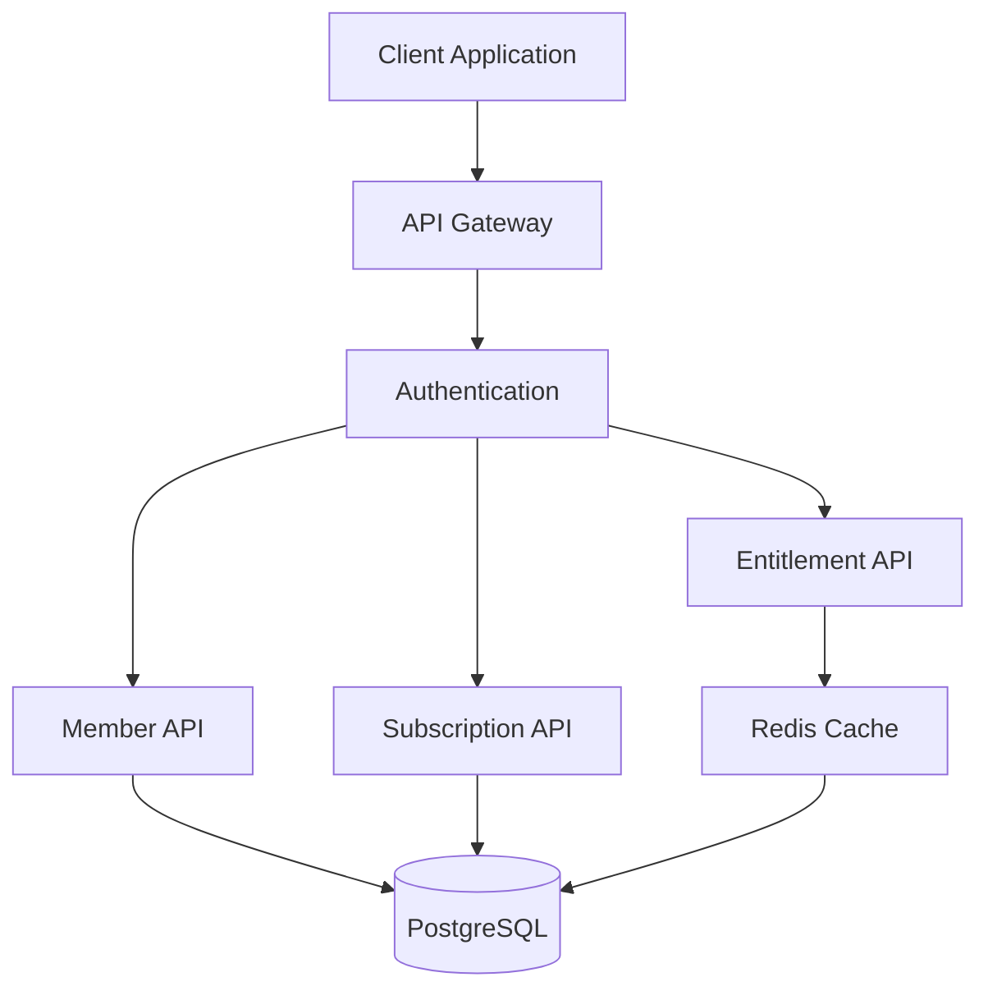
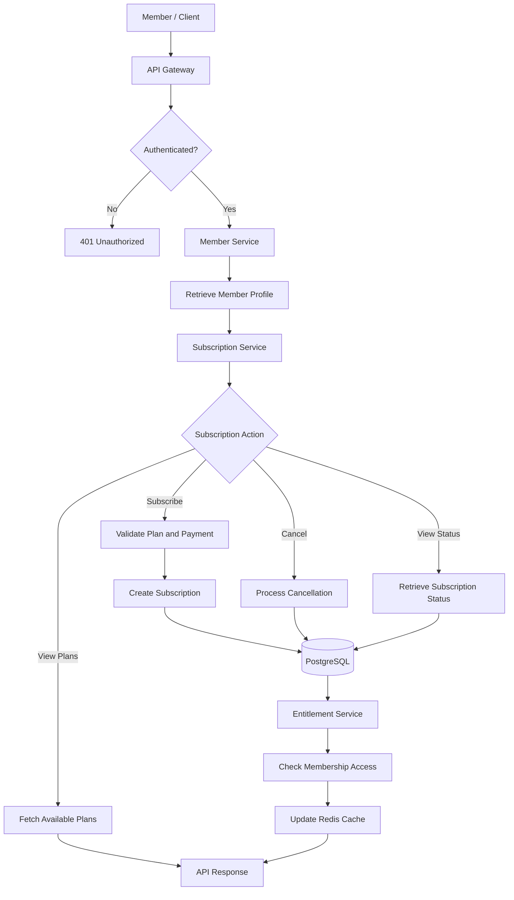

# Netflix Member & Commerce API Design

## 1. Objective

Design a RESTful API for a simplified Netflix-style platform supporting member accounts, profiles, subscriptions, and membership entitlements.

The API focuses on secure access, reliable subscription operations, consistent responses, and scalability.

## 2. System Overview

The proposed platform contains the following components:

- **API Gateway:** Handles incoming requests, authentication, and rate limiting.
- **Member Service:** Manages member accounts and profiles.
- **Subscription Service:** Manages membership plans, subscriptions, and renewals.
- **Entitlement Service:** Determines which features a member can access.
- **PostgreSQL:** Stores member, profile, plan, and subscription information.
- **Redis:** Caches frequently accessed plans and entitlement information.

## 3. High-Level Architecture



## 4. API Request and Subscription Flow

The following flow illustrates member authentication, subscription operations, and entitlement verification.



### Flow Explanation

1. The member sends a request through the client application.
2. The API Gateway validates authentication and applies rate limits.
3. The Member Service retrieves account and profile details.
4. The Subscription Service handles plan selection and subscription operations.
5. Subscription changes are stored in PostgreSQL.
6. The Entitlement Service checks available membership features.
7. Redis caches frequently accessed entitlement information.
8. The API returns the appropriate response.


## 5. API Standards

**Base URL:** `https://api.netflix.example.com/v1`

- Format: JSON
- Protocol: HTTPS
- Authentication: Bearer access token
- Versioning: URL-based (`/v1`)
- Content-Type: `application/json`

Common authentication header:

`Authorization: Bearer <access_token>`

## 6. Endpoint Specifications

### 6.1 Create a Member

**POST** `/members`

Creates a new member account.

Request:

```json
{
  "email": "member@example.com",
  "password": "StrongPassword123",
  "full_name": "Alex Morgan"
}
```

Response: `201 Created`

```json
{
  "member_id": "mem_1001",
  "email": "member@example.com",
  "full_name": "Alex Morgan",
  "status": "ACTIVE",
  "created_at": "2026-11-08T10:00:00Z"
}
```

Passwords must be securely hashed and must never be returned in API responses.

### 6.2 Retrieve Member Details

**GET** `/members/{member_id}`

Returns account information for the authenticated member.

Response: `200 OK`

```json
{
  "member_id": "mem_1001",
  "email": "member@example.com",
  "full_name": "Alex Morgan",
  "status": "ACTIVE"
}
```

### 6.3 Create a Profile

**POST** `/members/{member_id}/profiles`

Creates a viewing profile under a member account.

Request:

```json
{
  "profile_name": "Kids",
  "is_kids_profile": true,
  "language": "en"
}
```

Response: `201 Created`

```json
{
  "profile_id": "prof_2001",
  "member_id": "mem_1001",
  "profile_name": "Kids",
  "is_kids_profile": true,
  "language": "en"
}
```

### 6.4 List Member Profiles

**GET** `/members/{member_id}/profiles`

Response: `200 OK`

```json
{
  "profiles": [
    {
      "profile_id": "prof_2001",
      "profile_name": "Kids",
      "is_kids_profile": true
    },
    {
      "profile_id": "prof_2002",
      "profile_name": "Alex",
      "is_kids_profile": false
    }
  ]
}
```

### 6.5 Retrieve Available Plans

**GET** `/plans`

Returns available membership plans for the member's market.

Response: `200 OK`

```json
{
  "plans": [
    {
      "plan_id": "plan_basic",
      "name": "Basic",
      "billing_period": "MONTHLY"
    },
    {
      "plan_id": "plan_premium",
      "name": "Premium",
      "billing_period": "MONTHLY"
    }
  ]
}
```

### 6.6 Create a Subscription

**POST** `/members/{member_id}/subscriptions`

Creates a subscription for a member.

Request:

```json
{
  "plan_id": "plan_premium",
  "payment_method_id": "pm_3001"
}
```

Response: `201 Created`

```json
{
  "subscription_id": "sub_4001",
  "member_id": "mem_1001",
  "plan_id": "plan_premium",
  "status": "ACTIVE",
  "created_at": "2026-11-08T10:00:00Z"
}
```

Payment processing is delegated to a secure payment provider. The API does not store raw payment credentials.

### 6.7 Retrieve Current Subscription

**GET** `/members/{member_id}/subscriptions/current`

Response: `200 OK`

```json
{
  "subscription_id": "sub_4001",
  "plan_id": "plan_premium",
  "status": "ACTIVE",
  "renewal_date": "2026-12-08"
}
```

### 6.8 Cancel a Subscription

**POST** `/members/{member_id}/subscriptions/{subscription_id}/cancel`

Cancels a subscription according to the applicable billing policy.

Response: `200 OK`

```json
{
  "subscription_id": "sub_4001",
  "status": "CANCELLED",
  "message": "Subscription cancellation accepted."
}
```

### 6.9 Check Membership Entitlements

**GET** `/members/{member_id}/entitlements`

Checks which membership features are available.

Response: `200 OK`

```json
{
  "member_id": "mem_1001",
  "subscription_status": "ACTIVE",
  "features": {
    "streaming_access": true,
    "supported_profiles": 5,
    "premium_content": true
  }
}
```

## 7. Data Model

### Members

| Field | Type | Description |
|---|---|---|
| member_id | UUID | Primary key |
| email | VARCHAR | Unique email |
| password_hash | VARCHAR | Secure password hash |
| full_name | VARCHAR | Member name |
| status | VARCHAR | Account status |
| created_at | TIMESTAMP | Creation time |

### Profiles

| Field | Type | Description |
|---|---|---|
| profile_id | UUID | Primary key |
| member_id | UUID | Member reference |
| profile_name | VARCHAR | Profile name |
| is_kids_profile | BOOLEAN | Kids profile flag |
| language | VARCHAR | Preferred language |

### Plans

| Field | Type | Description |
|---|---|---|
| plan_id | UUID | Primary key |
| name | VARCHAR | Plan name |
| billing_period | VARCHAR | Billing frequency |

### Subscriptions

| Field | Type | Description |
|---|---|---|
| subscription_id | UUID | Primary key |
| member_id | UUID | Member reference |
| plan_id | UUID | Plan reference |
| status | VARCHAR | Subscription status |
| renewal_date | DATE | Next renewal date |

### Relationships

- One member can have multiple profiles.
- One member can have subscription history.
- Each subscription references a membership plan.
- Entitlements are determined using the member's active subscription and plan.


## 8. Error Handling

All API errors follow a consistent JSON structure.

Example:

```json
{
  "error": {
    "code": "RESOURCE_NOT_FOUND",
    "message": "The requested member was not found.",
    "request_id": "req_12345"
  }
}
```

### HTTP Status Codes

| Status | Meaning |
|---|---|
| 200 | Request successful |
| 201 | Resource created |
| 400 | Invalid request |
| 401 | Authentication required |
| 403 | Access denied |
| 404 | Resource not found |
| 409 | Conflict |
| 422 | Validation error |
| 429 | Rate limit exceeded |
| 500 | Internal server error |
| 503 | Service unavailable |

Validation errors should identify invalid fields without exposing internal system details.

## 9. Authentication and Security

- Use OAuth 2.0 / OpenID Connect for authentication.
- Validate access tokens on protected endpoints.
- Apply member-level authorization to prevent cross-account access.
- Hash passwords using Argon2id or another secure password hashing algorithm.
- Encrypt sensitive information in transit and at rest.
- Never expose payment credentials or internal database details.
- Maintain audit logs for important account and subscription changes.
- Validate all incoming request data.

## 10. Rate Limiting

Apply rate limits at the API Gateway based on authenticated identity and endpoint.

### Proposed Rate Limits

| Endpoint | Limit |
|---|---|
| Authentication | 5 requests/minute |
| Member APIs | 100 requests/minute |
| Profile APIs | 60 requests/minute |
| Plan APIs | 120 requests/minute |
| Subscription changes | 10 requests/minute |

These are initial design values and should be adjusted based on actual traffic and abuse patterns.

### Implementation

- Use Redis to maintain distributed rate-limit counters.
- Apply limits per member or client identity.
- Return `429 Too Many Requests` when a limit is exceeded.
- Include a `Retry-After` response header.
- Apply stricter limits to sensitive operations such as authentication and subscription changes.

## 11. Scalability and Reliability

### Application Layer

- Keep API services stateless so they can scale horizontally.
- Deploy multiple service instances behind a load balancer.
- Separate member, subscription, and entitlement workloads.

### Database Layer

- Add indexes on member_id, subscription_id, and email.
- Use connection pooling to manage database connections.
- Use read replicas for read-heavy workloads where appropriate.
- Introduce partitioning when subscription history grows significantly.

### Caching

- Cache frequently requested plans and entitlement information in Redis.
- Set appropriate cache expiration times.
- Invalidate or update cached entitlements when subscription status changes.

### Reliability

- Use idempotency keys for subscription creation and payment-related operations.
- Apply timeouts and retries with exponential backoff for external service calls.
- Use circuit breakers to prevent cascading failures.
- Monitor API latency, error rates, database load, and subscription failures.

## 12. Key Design Decisions and Trade-offs

**REST API:** Provides predictable resource-oriented endpoints and standard HTTP semantics.

**PostgreSQL:** Supports relational integrity for members, profiles, plans, and subscriptions.

**Redis:** Reduces repeated database reads but requires careful cache invalidation.

**Service separation:** Allows individual workloads to scale independently, but adds operational complexity.

**Idempotency:** Prevents duplicate subscription operations when clients retry requests.

**External payment provider:** Keeps sensitive payment processing outside the member API and reduces payment-data handling responsibilities.

## 13. Conclusion

This proposed API design provides a foundation for managing member accounts, viewing profiles, subscriptions, and membership entitlements.

It prioritizes secure access, reliable commerce operations, consistent API contracts, and scalability while keeping the design modular enough to evolve as product requirements grow.

---

**Project Scope:** This is an independent system design proposal created for the Netflix Software Engineer 4 API Design Challenge. It does not represent Netflix's internal architecture or APIs.
