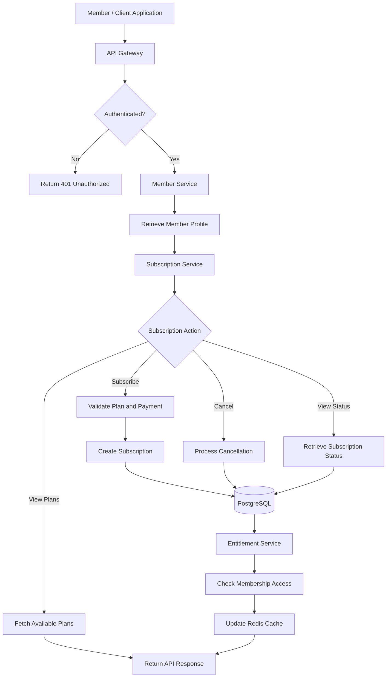

\# Netflix Member \& Commerce API Design


\## 1. Objective


Design a RESTful API for a simplified Netflix platform that supports member accounts, profiles, subscriptions, and membership entitlements.


The API should provide secure access, consistent responses, reliable subscription operations, and predictable performance as usage grows.


\## 2. System Overview


The platform consists of the following components:


\- API Gateway: Handles incoming requests, authentication, and rate limiting.

\- Member Service: Manages member accounts and profile information.

\- Subscription Service: Manages plans, subscription status, and renewals.

\- Entitlement Service: Determines which features a member can access.

\- PostgreSQL: Stores member, profile, plan, and subscription data.

\- Redis: Caches frequently accessed membership and entitlement information.


\## 3. Architecture


```mermaid

flowchart TD

&#x20;   A\["Client Application"] --> B\["API Gateway"]

&#x20;   B --> C\["Authentication"]

&#x20;   C --> D\["Member API"]

&#x20;   C --> E\["Subscription API"]

&#x20;   C --> F\["Entitlement API"]

&#x20;   D --> G\[("PostgreSQL")]

&#x20;   E --> G

&#x20;   F --> H\["Redis Cache"]

&#x20;   H --> G

```


## 4. API Request and Subscription Flow

This diagram shows how a member interacts with the platform, from authentication to subscription management and entitlement verification.



### Flow Explanation

1. The member sends a request through the client application.
2. The API Gateway validates authentication and applies rate limits.
3. The Member Service retrieves account and profile details.
4. The Subscription Service handles plan selection, subscription creation, cancellation, or status checks.
5. Subscription changes are stored in PostgreSQL.
6. The Entitlement Service checks the member's available features.
7. Redis caches frequently accessed entitlement information.
8. The API returns the response to the client.


\## 4. API Standards


Base URL:


`https://api.netflix.example.com/v1`


All request and response bodies use JSON.


Authentication:


`Authorization: Bearer <access\_token>`


Common headers:


\- Content-Type: application/json

\- Accept: application/json

\- Authorization: Bearer token


\## 5. Endpoint Specifications


\### 5.1 Create a Member


\*\*POST\*\* `/members`


Creates a new member account.


Request:


```json

{

&#x20; "email": "member@example.com",

&#x20; "password": "StrongPassword123",

&#x20; "full\_name": "Alex Morgan"

}

```


Response: `201 Created`


```json

{

&#x20; "member\_id": "mem\_1001",

&#x20; "email": "member@example.com",

&#x20; "full\_name": "Alex Morgan",

&#x20; "status": "ACTIVE",

&#x20; "created\_at": "2026-11-08T10:00:00Z"

}

```


Passwords must be securely hashed and never returned in API responses.


\### 5.2 Retrieve Member Details


\*\*GET\*\* `/members/{member\_id}`


Returns the authenticated member's account information.


Response: `200 OK`


```json

{

&#x20; "member\_id": "mem\_1001",

&#x20; "email": "member@example.com",

&#x20; "full\_name": "Alex Morgan",

&#x20; "status": "ACTIVE"

}

```


\### 5.3 Create a Profile


\*\*POST\*\* `/members/{member\_id}/profiles`


Creates a viewing profile under a member account.


Request:


```json

{

&#x20; "profile\_name": "Kids",

&#x20; "is\_kids\_profile": true,

&#x20; "language": "en"

}

```


Response: `201 Created`


```json

{

&#x20; "profile\_id": "prof\_2001",

&#x20; "member\_id": "mem\_1001",

&#x20; "profile\_name": "Kids",

&#x20; "is\_kids\_profile": true,

&#x20; "language": "en"

}

```


\### 5.4 List Member Profiles


\*\*GET\*\* `/members/{member\_id}/profiles`


Response: `200 OK`


```json

{

&#x20; "profiles": \[

&#x20;   {

&#x20;     "profile\_id": "prof\_2001",

&#x20;     "profile\_name": "Kids",

&#x20;     "is\_kids\_profile": true

&#x20;   },

&#x20;   {

&#x20;     "profile\_id": "prof\_2002",

&#x20;     "profile\_name": "Alex",

&#x20;     "is\_kids\_profile": false

&#x20;   }

&#x20; ]

}

```


\### 5.5 Retrieve Available Plans


\*\*GET\*\* `/plans`


Returns the membership plans available to a member's market.


Response: `200 OK`


```json

{

&#x20; "plans": \[

&#x20;   {

&#x20;     "plan\_id": "plan\_basic",

&#x20;     "name": "Basic",

&#x20;     "billing\_period": "MONTHLY"

&#x20;   },

&#x20;   {

&#x20;     "plan\_id": "plan\_premium",

&#x20;     "name": "Premium",

&#x20;     "billing\_period": "MONTHLY"

&#x20;   }

&#x20; ]

}

```


\### 5.6 Create a Subscription


\*\*POST\*\* `/members/{member\_id}/subscriptions`


Creates a subscription for a member.


Request:


```json

{

&#x20; "plan\_id": "plan\_premium",

&#x20; "payment\_method\_id": "pm\_3001"

}

```


Response: `201 Created`


```json

{

&#x20; "subscription\_id": "sub\_4001",

&#x20; "member\_id": "mem\_1001",

&#x20; "plan\_id": "plan\_premium",

&#x20; "status": "ACTIVE",

&#x20; "created\_at": "2026-11-08T10:00:00Z"

}

```


Payment processing should be delegated to a secure payment provider. Sensitive payment credentials must not be stored by this API.


\### 5.7 Retrieve Subscription Details


\*\*GET\*\* `/members/{member\_id}/subscriptions/current`


Response: `200 OK`


```json

{

&#x20; "subscription\_id": "sub\_4001",

&#x20; "plan\_id": "plan\_premium",

&#x20; "status": "ACTIVE",

&#x20; "renewal\_date": "2026-12-08"

}

```


\### 5.8 Cancel a Subscription


\*\*POST\*\* `/members/{member\_id}/subscriptions/{subscription\_id}/cancel`


Cancels the subscription according to the applicable billing policy.


Response: `200 OK`


```json

{

&#x20; "subscription\_id": "sub\_4001",

&#x20; "status": "CANCELLED",

&#x20; "message": "Subscription cancellation accepted."

}

```


\### 5.9 Check Membership Entitlements


\*\*GET\*\* `/members/{member\_id}/entitlements`


Checks which membership features are available.


Response: `200 OK`


```json

{

&#x20; "member\_id": "mem\_1001",

&#x20; "subscription\_status": "ACTIVE",

&#x20; "features": {

&#x20;   "streaming\_access": true,

&#x20;   "supported\_profiles": 5,

&#x20;   "premium\_content": true

&#x20; }

}

```


\## 6. Data Model


\### Members


| Field | Type | Description |

|---|---|---|

| member\_id | UUID | Primary key |

| email | VARCHAR | Unique email |

| password\_hash | VARCHAR | Secure password hash |

| full\_name | VARCHAR | Member name |

| status | VARCHAR | Account status |

| created\_at | TIMESTAMP | Creation time |


\### Profiles


| Field | Type | Description |

|---|---|---|

| profile\_id | UUID | Primary key |

| member\_id | UUID | Member reference |

| profile\_name | VARCHAR | Profile name |

| is\_kids\_profile | BOOLEAN | Kids profile flag |

| language | VARCHAR | Preferred language |


\### Plans


| Field | Type | Description |

|---|---|---|

| plan\_id | UUID | Primary key |

| name | VARCHAR | Plan name |

| billing\_period | VARCHAR | Billing frequency |


\### Subscriptions


| Field | Type | Description |

|---|---|---|

| subscription\_id | UUID | Primary key |

| member\_id | UUID | Member reference |

| plan\_id | UUID | Plan reference |

| status | VARCHAR | Subscription status |

| renewal\_date | DATE | Next renewal date |


Relationships:


\- One member can have multiple profiles.

\- One member can have subscription history.

\- Each subscription references a membership plan.


\## 7. Error Handling


Use consistent JSON error responses.


Example:


```json

{

&#x20; "error": {

&#x20;   "code": "RESOURCE\_NOT\_FOUND",

&#x20;   "message": "The requested member was not found.",

&#x20;   "request\_id": "req\_12345"

&#x20; }

}

```


HTTP status codes:


| Status | Meaning |

|---|---|

| 200 | Request successful |

| 201 | Resource created |

| 400 | Invalid request |

| 401 | Authentication required |

| 403 | Access denied |

| 404 | Resource not found |

| 409 | Conflict |

| 429 | Rate limit exceeded |

| 500 | Internal server error |

| 503 | Service unavailable |


Validation errors should identify the invalid fields without exposing internal system details.


\## 8. Authentication and Security


\- Use OAuth 2.0 / OpenID Connect for secure authentication.

\- Validate access tokens on protected endpoints.

\- Apply member-level authorization to prevent cross-account access.

\- Hash passwords using a secure password hashing algorithm such as Argon2id.

\- Encrypt sensitive information in transit and at rest.

\- Never expose payment credentials or internal database details.

\- Maintain audit logs for important account and subscription changes.


\## 9. Rate Limiting


Apply rate limits at the API Gateway, with limits varying by endpoint and authenticated identity.


Example proposed limits:


| Endpoint | Limit |

|---|---|

| Authentication | 5 requests/minute |

| Member APIs | 100 requests/minute |

| Profile APIs | 60 requests/minute |

| Plan APIs | 120 requests/minute |

| Subscription changes | 10 requests/minute |


Use Redis to maintain distributed rate-limit counters.


When a client exceeds its limit, return `429 Too Many Requests` with a `Retry-After` header.


These are initial design values and should be adjusted using traffic measurements and abuse patterns.


\## 10. Scalability and Reliability


\- Keep API services stateless so they can scale horizontally.

\- Use PostgreSQL indexes on member\_id, subscription\_id, and email.

\- Use connection pooling to manage database connections efficiently.

\- Cache frequently requested plans and entitlement data in Redis.

\- Invalidate or update cached entitlements when subscription status changes.

\- Use idempotency keys for subscription creation and payment-related operations.

\- Apply timeouts, retries with exponential backoff, and circuit breakers for external service calls.

\- Monitor request latency, error rates, database load, and subscription failures.


\## 11. Key Design Decisions and Trade-offs


\*\*REST API:\*\* Provides predictable resource-oriented endpoints and standard HTTP semantics.


\*\*PostgreSQL:\*\* Supports relational integrity for members, profiles, plans, and subscriptions.


\*\*Redis:\*\* Reduces repeated database reads but requires careful cache invalidation.


\*\*Separate services:\*\* Allows member, subscription, and entitlement workloads to scale independently, with additional operational complexity.


\*\*Idempotency:\*\* Prevents duplicate subscription operations when clients retry requests.


\## 12. Conclusion


This proposed API design provides a foundation for managing Netflix-style member accounts, viewing profiles, subscriptions, and entitlements.


It prioritizes secure access, reliable commerce operations, clear API contracts, and scalability while keeping the design modular enough to evolve as product requirements grow.


\---


\*\*Note:\*\* This document is an independent system design proposal and does not represent Netflix's internal architecture or APIs.


